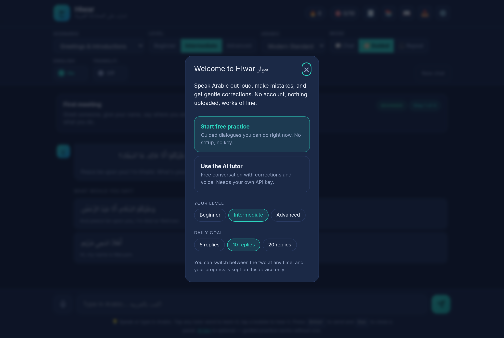
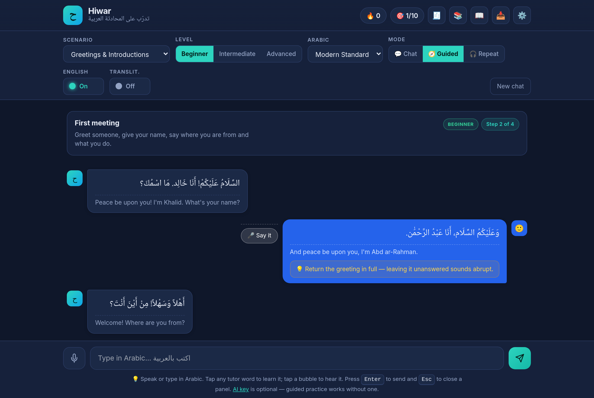
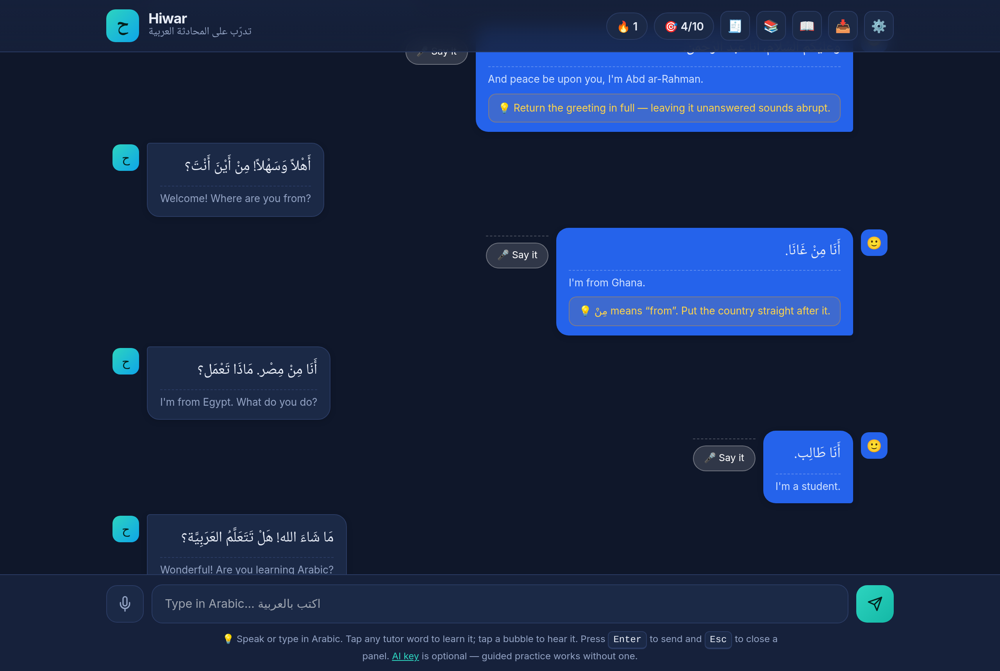
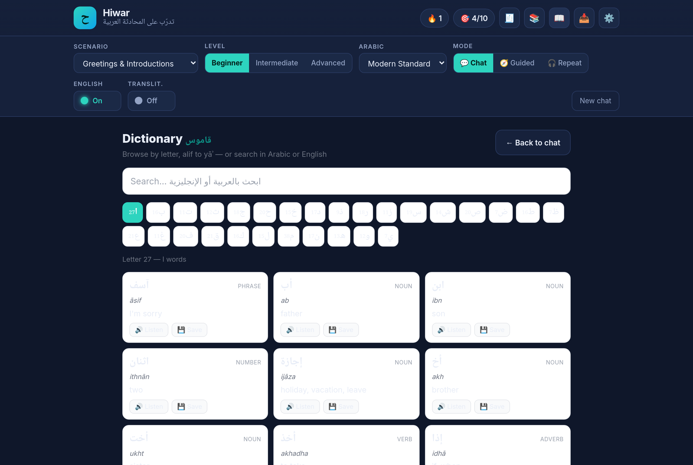

# Hiwar — حوار

**A patient AI tutor for Arabic conversation, free for the Ummah.**

Hiwar (حوار, "dialogue") gives every learner a judgment-free place to *speak* Arabic
out loud: you talk, a warm tutor answers in Arabic, corrects you gently, and keeps the
conversation moving. No account, no server, no tracking. Your practice stays on your
own device.

[**Open Hiwar in the browser**](https://hiwar-zynora1.vercel.app/) ·
[**Download the Windows app**](https://github.com/zynoraprime2026-dotcom/hiwar/releases/latest) ·
[Report a problem](https://github.com/zynoraprime2026-dotcom/hiwar/issues)

---

## Screenshots

| Guided practice | Your reply, scored on device | Scene complete |
|---|---|---|
|  |  |  |



## Why it exists

Private tutors cost money, apps want subscriptions, and most people learning Arabic
have nobody to practise with. Hiwar closes that gap: it runs on a phone, a laptop or a
Windows desktop, and it works with a free AI key. It is built as a service to the
Ummah — free to use, free to copy, free to improve.

## What it does

| | |
|---|---|
| 🧭 **Guided practice** | 21 scripted conversations that need no key, no account and no connection |
| 💬 **Real conversation** | Modern Standard Arabic, or Egyptian and Levantine dialect |
| 🎤 **Voice in, voice out** | Speak your reply with the mic; tap any bubble to hear it read aloud |
| ✏️ **Gentle corrections** | Mistakes explained in simple English with the corrected Arabic |
| 🎧 **Listen & repeat** | The tutor speaks a phrase, you repeat it, and your pronunciation is scored |
| 🎤 **Speak your guided replies** | Tap *Say it* on any guided line and get a score, on device, with no key |
| 👆 **Tap to learn** | Tap any word for its meaning, then save it to your vocabulary |
| 📖 **Built-in dictionary** | Browse alif to yāʾ, search in Arabic or English, works offline |
| 🎯 **Study hub** | Vocabulary quiz and mistakes flashcards built from your own practice |
| 🧾 **Session summary** | A recap of new words, weak points and what to practise next |
| 🎭 **21 scenes, three levels** | Beginner to advanced: market, taxi, pharmacy, school, mosque, hotel, airport, phone, opinions and more |
| 📊 **Three levels** | Beginner (vocalized, short), intermediate, advanced (idioms and nuance) |
| 🔥 **Streak & daily goal** | Small daily steps instead of one heroic session |
| 📱 **Installable everywhere** | Phone home screen, laptop window, or native Windows desktop app |
| 🔌 **Offline-ready** | The whole app shell is cached; only the AI needs a connection |
| 💾 **Backup & restore** | Export your streak, vocabulary and corrections to a JSON file |

## Where it runs

| | |
|---|---|
| **Vercel (primary)** | https://hiwar-zynora1.vercel.app — every push to `main` deploys automatically |
| **GitHub Pages (mirror)** | https://zynoraprime2026-dotcom.github.io/hiwar/ |
| **Windows 10/11** | Installer and portable `.exe` on the [releases page](https://github.com/zynoraprime2026-dotcom/hiwar/releases/latest) |

`vercel.json` pins the deployment to plain static files: no install step and no build step, so
Vercel serves `index.html` and the assets as they are.

## Get started

1. Open the app — in a browser, on a home screen, or in the Windows app.
2. Choose your level and daily goal, then **Start free practice** and work through a guided scene.
   Nothing to install, no key, no account; it runs offline.
3. When you want free conversation with corrections and voice, open **Settings ⚙️** and paste
   an API key from any OpenAI-compatible provider.
   [OpenRouter](https://openrouter.ai/keys) has a free tier; `openai/gpt-4o-mini` works well.
4. Pick a scenario and level, then speak or type in Arabic.

Your key is stored only on your own device, is never sent anywhere except the AI
provider you chose, and is deliberately **left out of exported backups**.

## Install

**Windows** — download from [Releases](https://github.com/zynoraprime2026-dotcom/hiwar/releases/latest):
`Hiwar Setup <version>.exe` installs normally (per-user, no admin rights needed);
`Hiwar <version>.exe` is portable — run it from anywhere, including a USB stick.

**Android** — Chrome menu → *Install app* (or the 📥 button inside Hiwar).

**iPhone / iPad** — Safari → Share → *Add to Home Screen*.

**Laptop browser** — the install icon in the address bar, or *Install Hiwar* in the menu.

## Run it locally

```bash
npm run serve      # http://localhost:4173 — no dependencies needed
npm run check      # validate scripts, JSON, asset references, service worker
```

Opening `index.html` directly also works, but a real http origin is needed for the
service worker and PWA install, so prefer `npm run serve`.

## Build the desktop app

```bash
npm install
npm start          # run the desktop shell
npm run dist:win   # Windows installer + portable .exe in dist/
npm run dist:mac   # macOS .dmg
npm run dist:linux # Linux AppImage
```

Windows builds are produced automatically by GitHub Actions
(`.github/workflows/desktop.yml`) on every push to `main`, and published as a GitHub
Release when you push a tag:

```bash
git tag v2.0.0
git push origin v2.0.0
```

The desktop shell (`electron/`) serves the app from a privileged `app://` origin, keeps
the renderer sandboxed (no Node access), opens external links in the system browser,
remembers window size and position, and adds a native menu with `Ctrl+N` for a new chat.

## Deploy the web app

- **Vercel** — import the repository; `vercel.json` already sets security headers, keeps
  `sw.js` uncached, and allows the microphone only for the app itself.
- **GitHub Pages** — served from `main`, no build step.
- **Netlify** — publish directory `.`, no build command.

The app is plain HTML, CSS and JavaScript with no bundler, so any static host works.

## Project layout

```
index.html          single-page app shell
css/style.css       theme, layout, responsive and accessibility rules
js/app.js           state, AI plumbing, chat, voice, repeat mode, quizzes
js/dictionary.js    offline dictionary data and lookup
js/vendor/          locally vendored Tailwind (no CDN, works offline)
fonts/              self-hosted Inter and Noto Naskh Arabic
electron/           desktop shell (main process + preload bridge)
scripts/            check.js (CI self-check), serve.js (local server)
manifest.json       PWA manifest and install shortcuts
sw.js               offline cache and navigation fallback
```

## Privacy

No accounts, no analytics, no backend. Streak, vocabulary, corrections, chat history
and your API key live in `localStorage` on your device. The only outbound request is to
the AI endpoint you configure. See [SECURITY.md](SECURITY.md).

## Contributing

Corrections to the Arabic, better scenarios, new dialects and accessibility fixes are
all welcome. Start with [CONTRIBUTING.md](CONTRIBUTING.md).

## License

[MIT](LICENSE) — use it, fork it, teach with it, ship it. Attribution is appreciated but
not required.

---

Built by [Abdul Rahim Abubakar](https://github.com/zynoraprime2026-dotcom) · صدقة جارية
for everyone learning Arabic.
